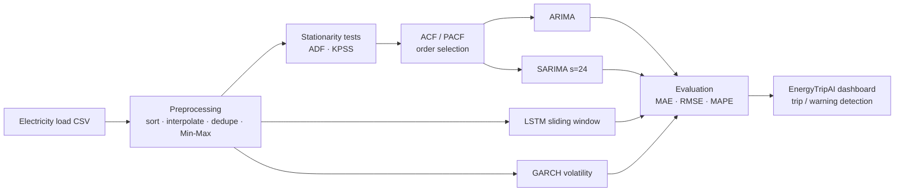

# Energy Transition Prediction: Time-Series Forecasting of Electricity Load

**Forecasting electricity demand with ARIMA, SARIMA, LSTM and GARCH, plus *EnergyTripAI*, an interactive dashboard that predicts overload and breaker-trip conditions before they happen.**

As grids move toward variable renewable generation, accurate load forecasting is essential for grid stability, efficient generation scheduling and outage prevention.

---

## Highlights

- Statistical (**ARIMA, SARIMA**) vs deep learning (**LSTM**) forecasting, plus **GARCH** for volatility
- Stationarity analysis with the **ADF** and **KPSS** tests, and order selection with **ACF/PACF**
- **Window-size ablation study** for the LSTM
- **EnergyTripAI dashboard**: CSV upload, breaker/voltage configuration, live forecasts, trip probability and stability score
- **LSTM is the best model**: MAPE **4.3%**, compared with 7.8% for ARIMA

## Pipeline



## Method

- **Preprocessing:** chronological sort, interpolation of missing values, duplicate removal, and Min-Max scaling X' = (X − Xmin) / (Xmax − Xmin)
- **ARIMA(p, d, q):** Yₜ = c + Σ φᵢ Yₜ₋ᵢ + Σ θⱼ εₜ₋ⱼ + εₜ
- **SARIMA(p, d, q)(P, D, Q)ₛ:** s = 24 captures the daily cycle in hourly data
- **LSTM:** forget, input and output gates learn long-term, nonlinear dependencies from a sliding window of past loads
- **Split:** 80% train / 20% test (chronological)

### Trip-threshold logic (EnergyTripAI)

$$
P_{max} = V \times I = 230\,\text{V} \times 15\,\text{A} = 3450\,\text{W}, \qquad P_{warn} = 0.8 \times P_{max}
$$

Each forecast step is classified as **Normal**, **Warning** (above P_warn) or **Trip** (above P_max).

## Results

**Model comparison**

| Model | MAE | RMSE | MAPE |
|---|---|---|---|
| ARIMA | 14.2 | 18.6 | 7.8% |
| SARIMA | 11.9 | 16.4 | 6.1% |
| **LSTM** | **9.1** | **13.5** | **4.3%** |

**LSTM window-size ablation**

| Window size | RMSE | MAE |
|---|---|---|
| 12 | 18.6 | 12.3 |
| 24 | 15.2 | 10.1 |
| 48 | 13.9 | 9.2 |
| **72** | **13.5** | **9.0** |

Larger windows capture longer temporal dependencies and improve accuracy.

**Stationarity tests**

| Test | Statistic | p-value | Conclusion |
|---|---|---|---|
| ADF | −3.3917 | 0.0112 | Reject H₀ (non-stationary), so the series is stationary |
| KPSS | 0.3387 | 0.10 | Fail to reject H₀ (stationary), so the series is stationary |

Dataset: about **50,000 samples** over multiple days, with a 15 A breaker and a 230 V system.

## Project Structure

```
Energy-Transition-Prediction-Time-Series-Forecasting/
├── data/                   # electricity load CSV (timestamp, load)
├── src/
│   ├── preprocessing.py    # cleaning, scaling, ADF/KPSS, ACF/PACF
│   ├── models.py           # ARIMA, SARIMA, LSTM, GARCH
│   └── train_evaluate.py   # training, metrics, window ablation
├── app/
│   └── energytrip_app.py   # Streamlit EnergyTripAI dashboard
└── requirements.txt
```

## Getting Started

```bash
pip install -r requirements.txt
python src/train_evaluate.py --data data/load.csv --time-col timestamp --target load
streamlit run app/energytrip_app.py
```

## Tech Stack

Python · statsmodels · TensorFlow/Keras · arch · pandas · NumPy · Plotly · Streamlit

## References

1. G. Box & G. Jenkins, *Time Series Analysis: Forecasting and Control*.
2. S. Hochreiter & J. Schmidhuber, "Long Short-Term Memory," *Neural Computation*, 1997.
3. W. Kong et al., *Short-Term Residential Load Forecasting Based on LSTM*.
4. J. Taylor, *Short-Term Electricity Demand Forecasting*.
5. S. Smyl, *Hybrid Statistical and Neural Network Models* (2020).
6. T. Hong, *Global Energy Forecasting Competition*.

## Team

Amrita School of Artificial Intelligence, Amrita Vishwa Vidyapeetham, Coimbatore

- Dodla Nithya Sai
- M. Vishnu Vardhan
- P. Sreekar Reddy
- S. Beena Reddy
